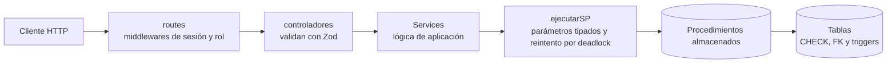
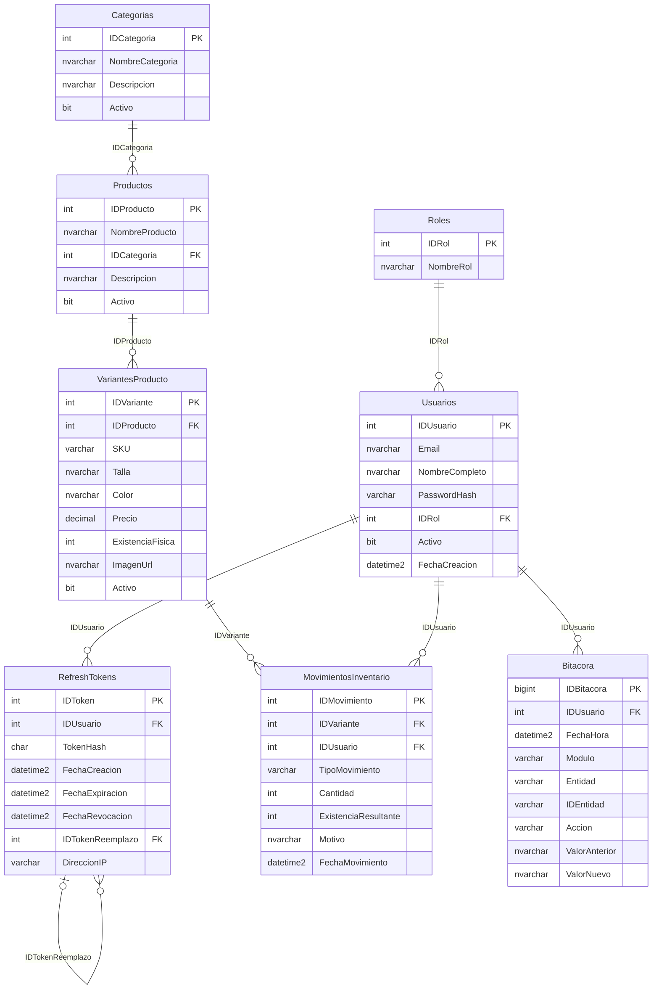
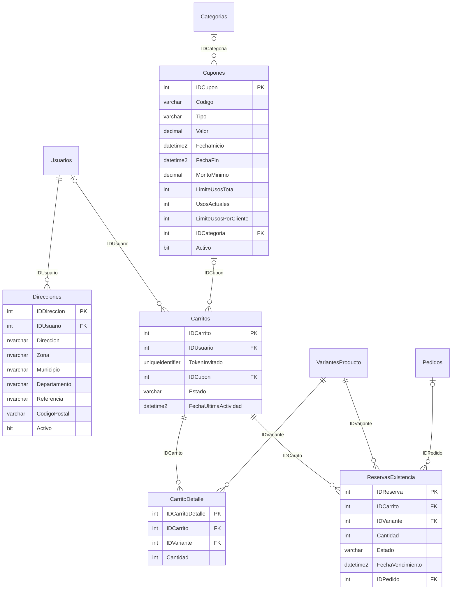
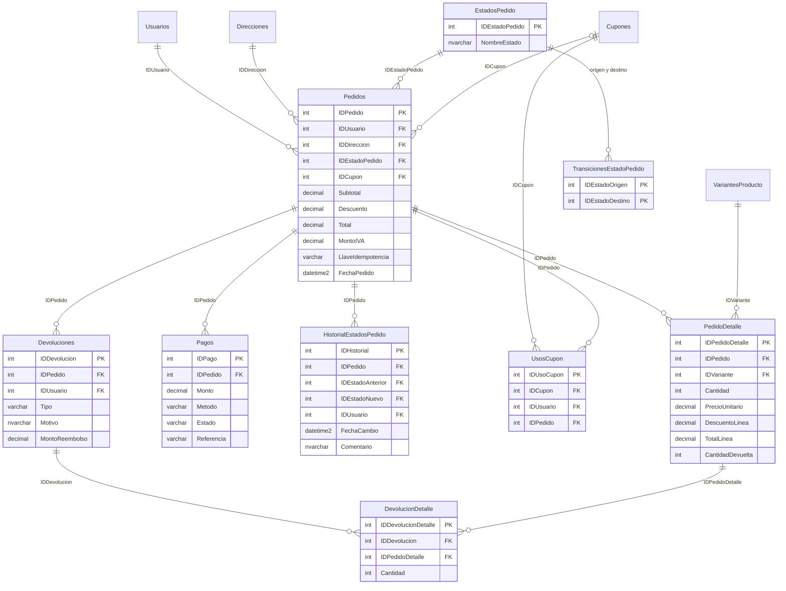
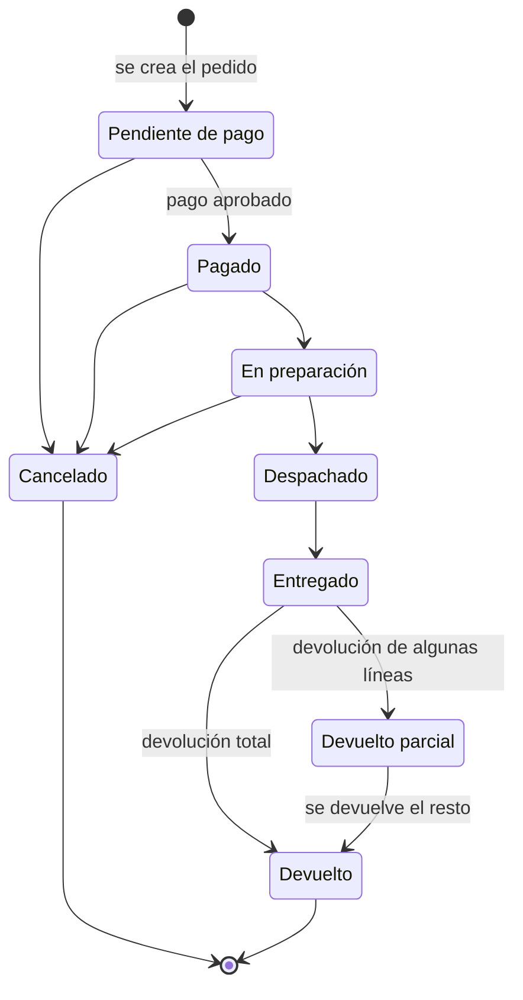

# CarritoVenta – Carrito de compras (Tech Challenge 360)

Sistema de carrito de compras con **SQL Server**, **Node.js + TypeScript (Express)** y, en la fase 2, **React + TypeScript**.
Cubre autenticación con roles, catálogo, inventario con kardex, carrito (invitado y cliente), cupones, checkout con reserva de existencia e idempotencia,
pedidos con devoluciones, dashboard de reportes y una bitácora de auditoría inmutable.

> **Estado:** base de datos y backend completos y probados (fase 1). El frontend corresponde a la fase 2.

---

## Contenido

1. [Stack](#stack)
2. [Arquitectura](#arquitectura)
3. [Instalación y ejecución](#instalación-y-ejecución)
4. [Credenciales de prueba](#credenciales-de-prueba)
5. [Modelo de datos (diagrama ER)](#modelo-de-datos-diagrama-er)
6. [Estados del pedido](#estados-del-pedido)
7. [Documentación de la API (Swagger)](#documentación-de-la-api-swagger)
8. [Decisiones técnicas](#decisiones-técnicas)
9. [Códigos de error](#códigos-de-error)
10. [Pruebas](#pruebas)
11. [Limitaciones conocidas](#limitaciones-conocidas)
12. [Estructura del proyecto](#estructura-del-proyecto)

---

## Stack

| Capa | Tecnología |
|---|---|
| Base de datos | SQL Server 2019+ (todo el acceso a datos por **procedimientos almacenados**) |
| Backend | Node.js 24+, TypeScript en modo estricto, Express 5 |
| Validación | Zod 4 (`strictObject`: se rechazan campos desconocidos) |
| Acceso a datos | `mssql` (parámetros tipados, parámetros con valor de tabla) |
| Seguridad | `bcryptjs`, `jsonwebtoken`, `helmet`, `cors`, `express-rate-limit` |
| Documentación | OpenAPI 3 + Swagger UI, generada desde los esquemas Zod |
| Frontend (fase 2) | React 18+ con TypeScript |

## Arquitectura



Cada capa tiene una sola responsabilidad:

- **routes**: define la URL y quién puede usarla (sesión opcional, obligatoria o rol).
- **controladores**: validan la entrada con Zod y devuelven el código HTTP; no contienen lógica de negocio.
- **Services**: arman los parámetros y traducen el resultado de los procedimientos.
- **procedimientos almacenados**: reglas de negocio, transacciones, bloqueos y auditoría. Cada operación que modifica datos corre dentro de una transacción.
- **tablas**: la última defensa (restricciones `CHECK`, llaves foráneas, índices únicos filtrados y triggers que impiden alterar registros históricos).

Un manejador de errores central responde siempre con la misma forma: `{ "error": { "codigo", "mensaje", "detalles" } }`. Nunca se devuelve la pila ni mensajes crudos de SQL Server.

## Instalación y ejecución

### Requisitos

- Node.js 24 o superior y `pnpm`
- SQL Server 2019 o superior (local, Docker o hosting)

### 1. Base de datos

Los scripts están en `database/` y se numeran en orden de ejecución (`001`…`012`, `014`, `016`).

**Servidor propio** (crea y reconstruye la base `CarritoVenta`):

```
sqlcmd -S localhost -U sa -P "<clave>" -b -i database/Instalar_Todo.sql
sqlcmd -S localhost -U sa -P "<clave>" -b -i database/016_Direcciones_Estados.sql
```

**Hosting compartido** (la base ya existe y no se puede borrar): conéctese a la base y ejecute `database/Reinstalar_Remoto.sql`.
Borra los objetos de CarritoVenta de esa base y los vuelve a crear (001–012, 014 y 016) con los datos semilla. Es **destructivo**: elimina todos los datos.

> `013_Pruebas.sql` (201 pruebas) debe ejecutarse **una sola vez sobre una base recién creada** y deja datos de prueba; no la ejecute sobre la base que usará la API.
> `015_Permisos.sql` crea un usuario de solo `EXECUTE` para servidores propios (no aplica en hosting compartido).

### 2. Backend

```
pnpm install
cp .env.example .env      # complete los valores (ver tabla)
pnpm dev                  # recarga automática; la API queda en http://localhost:3000
```

| Variable | Descripción |
|---|---|
| `PORT` | Puerto de la API (3000) |
| `CORS_ORIGINS` | Orígenes del frontend permitidos, separados por coma |
| `DB_SERVER`, `DB_PORT`, `DB_INSTANCE` | Servidor SQL Server (use `DB_INSTANCE` solo con instancias con nombre) |
| `DB_NAME`, `DB_USER`, `DB_PASSWORD` | Base y credenciales |
| `DB_ENCRYPT`, `DB_TRUST_SERVER_CERT` | Opciones de la conexión TLS |
| `JWT_SECRET` | Clave de firma de los JWT, mínimo 32 caracteres aleatorios |
| `JWT_ACCESS_MINUTES` | Vida del access token (15) |
| `REFRESH_TOKEN_DAYS` | Vida del refresh token (7) |
| `BCRYPT_ROUNDS` | Costo de bcrypt (10) |
| `RATE_LIMIT_GENERAL_MAX`, `RATE_LIMIT_AUTH_MAX` | Solicitudes por IP cada 15 minutos (300 y 20) |

El archivo `.env` **no se sube al repositorio** (está en `.gitignore`).

Comprobaciones rápidas: `GET /api/salud` debe responder `{ "estado": "ok", "baseDeDatos": "ok" }` y la documentación está en `http://localhost:3000/api/docs`.

Scripts: `pnpm dev`, `pnpm build`, `pnpm start`, `pnpm typecheck`, `pnpm test:endpoints`, `pnpm docs:validar`.

## Credenciales de prueba

Contraseña de las tres cuentas: **`Prueba123!`**

| Correo | Rol | Puede |
|---|---|---|
| `admin@CarritoVenta.test` | Administrador | Todo: usuarios, catálogo, cupones, reportes, bitácora, verificación de inventario |
| `operador@CarritoVenta.test` | Operador | Inventario y pedidos (avanzar estados, devoluciones, cancelar) |
| `cliente@CarritoVenta.test` | Cliente | Carrito, direcciones, checkout y sus propios pedidos |

Cupones de ejemplo: `BIENVENIDO10` (10 %, mínimo Q100), `ENVIO25` (Q25 desde Q200), `ROPA15` (15 % solo en Ropa), `VENCIDO5` (vencido) y `AGOTADO20` (agotado).
Un invitado (sin cuenta) puede llenar un carrito con la cabecera `x-carrito-token`.

## Modelo de datos (diagrama ER)

22 tablas, con nombres y llaves según el estándar del reto (`IDProducto`, `IDPedido`…). Se muestra por módulos para que sea legible;
las entidades compartidas aparecen solo con su llave. El diagrama completo está en [`docs/er-completo.png`](docs/er-completo.png).

### Acceso, catálogo e inventario



### Carrito, cupones y reservas



### Pedidos, pagos y devoluciones



Notas del modelo: la existencia disponible no es una columna; se calcula como `ExistenciaFisica` menos las reservas vigentes (`FU_Inventario_Disponibilidad`).
Cada movimiento del kardex guarda la cantidad **con signo** y la existencia resultante, de modo que la existencia física debe igualar la suma de los movimientos
(`GET /api/inventario/verificar` lo comprueba). Los precios van en `DECIMAL(18,2)`.

## Estados del pedido



- Las transiciones válidas están en la tabla `TransicionesEstadoPedido`. Se validan **dos veces**: en el procedimiento (error 50192) y en un trigger (error 50001), de modo que ni un `UPDATE` directo puede saltarse el flujo.
- Una vez **despachado**, el pedido ya no se puede cancelar. Cancelar reintegra la existencia con movimientos de devolución en el kardex y marca el pago como reembolsado.
- El personal solo puede asignar *En preparación*, *Despachado* y *Entregado* por `PATCH /pedidos/{id}/estado`. *Cancelado* y *Devuelto* tienen su propia vía porque mueven existencia y dinero.
- Cada cambio queda en `HistorialEstadosPedido` y en la bitácora, con el usuario, la fecha y los valores anterior y nuevo.
- El historial, el kardex, los pedidos y los pagos **no se modifican ni se eliminan** (triggers `INSTEAD OF`).

## Documentación de la API (Swagger)

Con la API en marcha:

- **Interactiva:** <http://localhost:3000/api/docs>
- **Especificación OpenAPI (JSON):** <http://localhost:3000/api/docs.json>

La especificación **se genera a partir de los mismos esquemas Zod** que validan las solicitudes, así que no puede quedar desactualizada respecto de lo que la API acepta.
Documenta las 55 operaciones con su rol requerido, cuerpo, parámetros, ejemplos y respuestas de error.
Para probar un endpoint protegido: ejecute `POST /auth/login`, copie el `accessToken` y péguelo en **Authorize**.

`pnpm docs:validar` comprueba que la especificación sea válida, que documente **exactamente** las rutas que existen en Express y que los ejemplos pasen la validación real.

Además, la colección de Postman con pruebas automáticas está en [`postman/`](postman/).

| Módulo | Prefijo | Quién |
|---|---|---|
| Sesión | `/api/auth` | Público (`/yo` requiere sesión) |
| Catálogo | `/api/catalogo` | Público |
| Carrito | `/api/carrito` | Invitado o Cliente |
| Direcciones y checkout | `/api/direcciones`, `/api/checkout` | Cliente |
| Pedidos | `/api/pedidos` | Cliente (los suyos), Operador y Administrador |
| Inventario | `/api/inventario` | Operador y Administrador (verificar y liberar reservas: Administrador) |
| Administración | `/api/usuarios`, `/api/categorias`, `/api/productos`, `/api/variantes`, `/api/cupones` | Administrador |
| Reportes y bitácora | `/api/reportes`, `/api/bitacora` | Administrador |

## Decisiones técnicas

**Todo el acceso a datos es por procedimientos almacenados.** Las reglas de negocio y las transacciones viven junto a los datos: un cliente que se salte la API sigue sin poder romper una regla.
No se concatena texto en ninguna consulta, así que no hay inyección SQL. Las listas (variantes de un producto, entradas de inventario, líneas de una devolución) viajan en **parámetros con valor de tabla (TVP)**: una sola ida a la base y una sola transacción.

**Concurrencia en el inventario.**
- La existencia disponible es `ExistenciaFisica − reservas vigentes`. Al reservar, las filas de las variantes se bloquean con `UPDLOCK, HOLDLOCK` **siempre en orden ascendente de `IDVariante`**; con el mismo orden en todas las transacciones, dos carritos que comparten productos no se bloquean entre sí.
- Si aun así SQL Server aborta una transacción por deadlock (error 1205), el backend la reintenta hasta 3 veces. Si se agota el tiempo de bloqueo (`LOCK_TIMEOUT`, error 1222) se responde 503.
- Las reservas duran 15 minutos y el precio queda congelado en la reserva; si cambió antes de pagar se responde 409 (50175).
- Se intenta activar `READ_COMMITTED_SNAPSHOT` para que las lecturas no bloqueen; en hosting compartido puede no estar permitido y el sistema sigue siendo correcto porque la integridad la dan los bloqueos explícitos.

**Checkout en dos pasos e idempotente.** `reservar` congela existencia y precio; `pagar` crea pedido, pago, movimientos de kardex, uso de cupón y bitácora en **una sola transacción**.
El cliente envía una llave UUID por intento de pago. `sp_getapplock` serializa los intentos con la misma llave y la repetición devuelve el pedido ya creado (200) en lugar de cobrar dos veces. El pago es **simulado** (referencia `SIM-…`).

**Dinero y cupones.** `DECIMAL(18,2)` en todo (un `FLOAT` acumularía errores de redondeo). El IVA viene **incluido** en el precio: `MontoIVA = Total × 12 / 112`.
El descuento de un cupón se prorratea entre las líneas y el residuo de redondeo se asigna a la línea de mayor monto, de modo que la suma de descuentos por línea es exactamente el descuento del cupón.
En una devolución parcial el reembolso se calcula de forma **acumulada**, para que los centavos siempre cuadren (3 devoluciones de 1 unidad de Q10.00 suman Q10.00, no Q9.99).

**Autenticación.**
- Access token JWT (HS256) de 15 minutos con `sub` y rol; refresh token **opaco** de 48 bytes aleatorios y 7 días.
- El refresh token se guarda como **SHA-256** y no con bcrypt: tiene 384 bits de entropía (no se adivina por fuerza bruta) y hay que buscarlo por igualdad, cosa que bcrypt (con sal) no permite.
- **Rotación con detección de reutilización:** cada renovación invalida el token anterior; si alguien presenta uno ya usado se asume robo y se revocan todas las sesiones del usuario.
- Las contraseñas usan bcrypt y se valida el límite de 72 **bytes** (no caracteres). El login responde el mismo 401 con o sin correo existente (y compara contra un hash falso para igualar el tiempo).
- Rol y usuario activo se verifican en el middleware **y** otra vez dentro de los procedimientos sensibles.

**Carrito de invitado.** El cliente nunca envía un `IDCarrito`: el dueño sale del token (usuario) o de la cabecera `x-carrito-token` (invitado). Así no existe el acceso a carritos ajenos por cambiar un identificador.
Al iniciar sesión se llama `POST /carrito/fusionar` para pasar el carrito del invitado al cliente. Un `Authorization` inválido responde 401 y nunca se degrada a invitado.

**Auditoría inmutable.** La bitácora registra quién, cuándo, qué y los valores anterior y nuevo (JSON), **dentro de la misma transacción** que el cambio. Triggers `INSTEAD OF UPDATE/DELETE` impiden alterarla; lo mismo con el kardex, el historial de estados, los pedidos y los pagos.

**Reportes.** Se agrupan en hora de Guatemala (`AT TIME ZONE 'Central America Standard Time'`) aunque las fechas se guarden en UTC. Excluyen pedidos pendientes de pago, cancelados y devueltos por completo, y restan devoluciones parciales.

**Otras.** Productos, usuarios y direcciones **no se borran**, se desactivan (para no romper pedidos históricos). Validación estricta con Zod (campos desconocidos se rechazan). Cabeceras de seguridad con `helmet`, CORS con lista de orígenes (nunca `*`), límite de cuerpo de 100 kb y límite de solicitudes por IP.

## Códigos de error

Los procedimientos lanzan errores `50xxx` con `THROW`; `src/errors/errorSql.ts` los traduce a HTTP. El detalle completo está al inicio de `database/008_SP_Acceso.sql`.

| Rango | Módulo | Ejemplos |
|---|---|---|
| 50001–50003 | Triggers | 50001 transición no permitida (409) · 50002/50003 registro inmutable (403) |
| 50101–50114 | Acceso | 50101 correo duplicado (409) · 50111–50113 refresh token inválido, reutilizado o vencido (401) · 50114 usuario inactivo (403) |
| 50121–50135 | Catálogo e inventario | 50121 duplicado (409) · 50131 existencia negativa (409) · 50132 bajo lo reservado (409) |
| 50141–50147 | Carrito | 50142 carrito ajeno (403) · 50144 excede la existencia (409) |
| 50151–50163 | Cupones | 50154 cupón vencido (409) · 50161 código duplicado (409) · 50163 no existe (404) |
| 50171–50175 | Checkout | 50173 carrito vacío (400) · 50174 reserva vencida (409) · 50175 el precio cambió (409) |
| 50181–50193 | Direcciones y pedidos | 50183 pedido ajeno (403) · 50184 no existe (404) · 50192 transición no permitida (409) |
| 50201–50204 | Devoluciones | 50203 excede lo vendido (409) |
| 50211 | Reportes | parámetro inválido (400) |
| 1205 / 1222 | SQL Server | deadlock (se reintenta) / tiempo de bloqueo agotado (503) |

## Pruebas

| Prueba | Qué cubre | Cómo ejecutarla |
|---|---|---|
| **201 pruebas SQL** (`database/013_Pruebas.sql`) | Reglas de los procedimientos, errores y efectos en tablas, contra SQL Server real | En una base **recién creada**, una sola vez |
| **1690 verificaciones simuladas** (`pruebas/endpoints-simulados.ts`) | Cada endpoint: rutas, esquemas, matriz de roles, parámetros y traducción de errores, con un pool de base de datos simulado que lee las firmas reales de los `.sql`. Se validaron con pruebas de mutación | `pnpm test:endpoints` |
| **Colección Postman** (`postman/`, 104 peticiones, 142 aserciones) | Recorrido completo contra SQL Server real: sesión, carrito de invitado y fusión, cupón, reserva, pago idempotente, pedidos, devoluciones parciales, cancelación, inventario, reportes, bitácora, permisos por rol, IDOR y robo de refresh token | Importar y **Run collection**; antes subir `RATE_LIMIT_AUTH_MAX` a 200 |
| **Validación de la documentación** (`pruebas/validar-openapi.ts`) | Especificación válida, cobertura exacta de rutas y ejemplos válidos | `pnpm docs:validar` |

Resultado de la última corrida de Postman contra SQL Server real: **104 peticiones, 142 aserciones, 0 fallas**.

## Limitaciones conocidas

Se documentan a propósito: conocer los límites es parte de la decisión técnica.

- **Concurrencia sin pruebas de carga.** El diseño usa bloqueos ordenados y reintentos por deadlock y se probó a mano con dos sesiones, pero no se midió el rendimiento con muchos usuarios simultáneos.
- **Usuario desactivado.** Sigue operando hasta que venza su access token (máximo 15 minutos); sus refresh tokens sí se revocan. Verificar el estado en cada petición cerraría la brecha a cambio de una consulta más.
- **Pago simulado.** El diseño (reserva, idempotencia, transacción única) es el de una pasarela real; con una pasarela habría que llamarla fuera de la transacción con un estado intermedio.
- **El registro revela si un correo ya existe** (409), a diferencia del login. Se mitiga con el límite de solicitudes de autenticación.
- **Límites por IP**, no por cuenta; falta un bloqueo temporal tras varios intentos fallidos.
- **Cuenta de base de datos** `db_owner` en el hosting; `015_Permisos.sql` define la cuenta de solo ejecución para un servidor propio.
- `imagenUrl` se valida como URL pero acepta cualquier esquema (debería limitarse a `http` y `https`).
- La paginación fuera de rango devuelve `total: 0` porque el total se calcula sobre las filas devueltas.
- Los procedimientos del carrito no revalidan que el producto siga activo; el control fuerte ocurre al reservar.

## Estructura del proyecto

```
database/             scripts SQL numerados (001–016), Instalar_Todo.sql y Reinstalar_Remoto.sql
src/
  app.ts, server.ts   aplicación Express y arranque
  config/             variables de entorno validadas
  db/                 pool, ejecutarSP, parámetros tipados y TVP
  routes/             URL, sesión y rol
  controladores/      validan con Zod y responden
  Services/          lógica de aplicación sobre los procedimientos
  schemas/            esquemas Zod (fuente de verdad de la validación y de Swagger)
  middlewares/        autenticación, roles, límites y errores
  errors/             AppError y traducción de errores SQL
  docs/               generación de OpenAPI y Swagger UI
pruebas/              pruebas simuladas de endpoints y validación de la documentación
postman/              colección y entorno de Postman
docs/                 diagramas ER (.mmd y .png)
```
